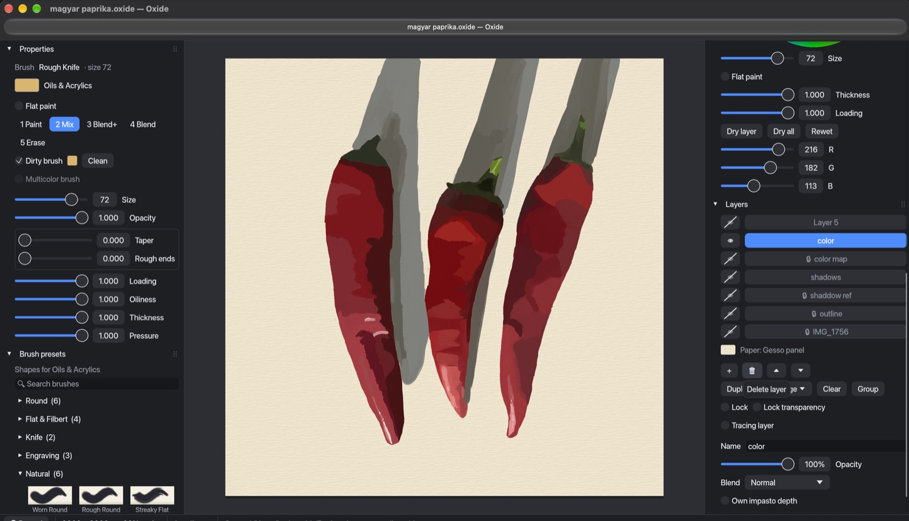
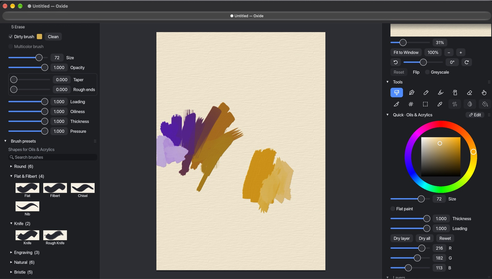
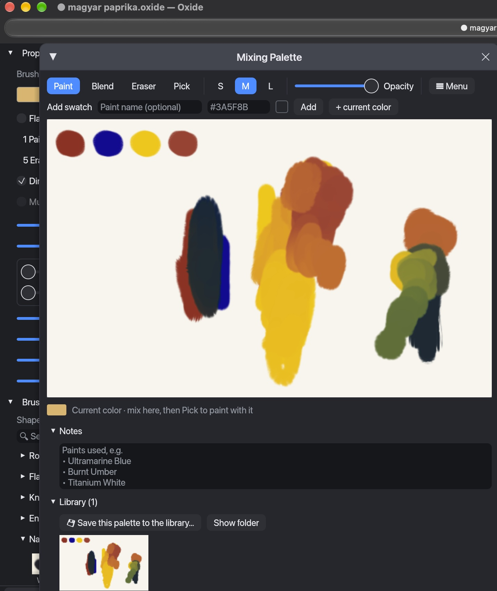
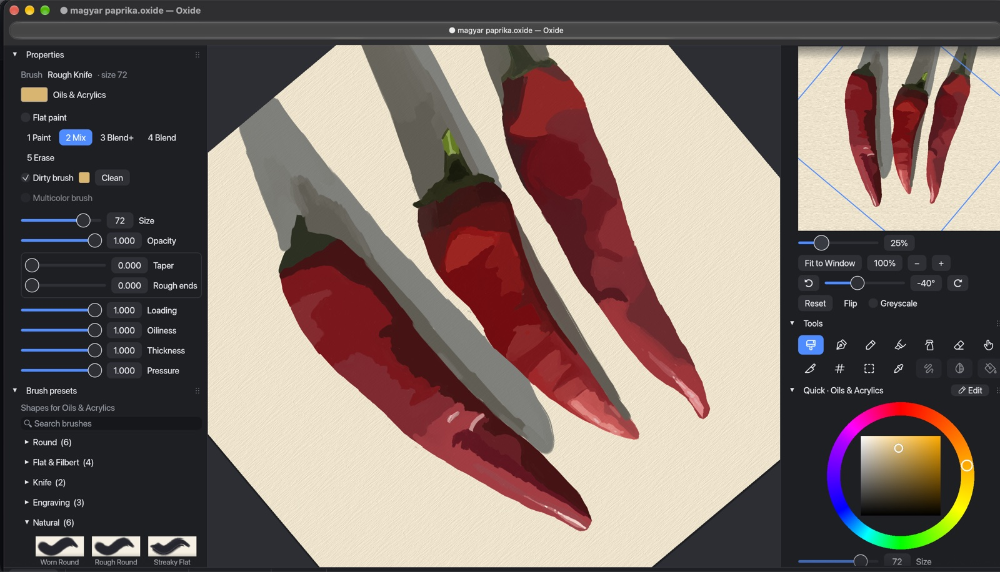

# Oxide

[](https://ko-fi.com/kevingaddy)

A natural-media painting app written in Rust. It's developed on macOS and also builds for Windows and Linux. It focuses on **oils, acrylics and pen & ink**: paint that stays wet, smears and mixes like real pigment (blue + yellow = green), and builds up thick impasto that catches the light. AI agents such as Claude can paint in it too, through a built-in MCP server.



> **Status:** early and in active development. The `.oxide` file format may still change. macOS is the main, tested platform; Windows and Linux compile but haven't been tried on real machines yet (see [Platform support](#platform-support)).

## Features

- **Oils & Acrylics:** wet paint that the brush picks up and drags. Oiliness sets how it behaves: low covers like acrylic, high blends like oil. Paint modes are Paint, Mix, Blend+, Blend and Erase, and there's a Dirty brush option.
- **Pigment color mixing:** spectral (Kubelka-Munk style) mixing, ported from [spectral.js](https://github.com/rvanwijnen/spectral.js), on the canvas and on a mixing palette.
- **Impasto and surfaces:** thick paint keeps its height and is lit. Paper, canvas, linen and panel surfaces have adjustable depth and lighting.
- **More tools:** Ink, Pencil, Marker, Airbrush, Eraser, Smudge, Palette Knife, Hatch (engraving-style line fills), Select and Picker.
- **Layers:** groups, blend modes, locks, a tracing layer, and a Reference Image window to paint from.
- **Color picker:** a hue wheel (with a painter's RYB option) or a classic saturation/brightness square with hue, saturation and brightness sliders. Choose in Settings.
- **Importing brushes:** bring in downloaded Photoshop (`.abr`), Procreate (`.brush`, `.brushset`) and GIMP (`.gbr`, `.gih`) brushes with **File → Import Brushes…** (or drop the files on the window). Each tip arrives as a brush preset with the name, spacing, roundness, angle and jitter from its file, ready to edit in the Brush Creator. Only the tip shape comes across, not the other app's pressure curves or grain textures. Pictures (PNG, JPEG and so on) can be used as tips too.
- **Pen tablets:** pressure, tilt and barrel rotation, with a pressure curve and stroke smoothing. Tested on macOS; written for Windows and Linux (Wayland) but untried.
- **Files:** a native `.oxide` format that keeps wet paint and impasto. Export to PNG, JPEG, BMP, TIFF, WebP and layered PSD.
- **Scripting and AI agents:** an MCP server (`oxide-mcp`) and a JSON command runner (`oxide-run`). The app can also record what you paint as a replayable script.

## Screenshots

| | |
|:---:|:---:|
|  |  |
| Wet oils with flat, filbert and knife brushes | The mixing palette |
|  | |
| Rotate the canvas to paint at a natural angle | |

## Download

Ready-made builds are on the [**Releases** page](https://github.com/kgaddy/Oxide/releases) (no Rust needed):

| Platform | Download | Status |
|---|---|---|
| **macOS** (Apple Silicon: M1 and later) | `Oxide-<version>-macos-arm64.zip` | Tested |
| **Windows** (64-bit) | `Oxide-<version>-windows-x64.zip` | Untested |
| **Linux** (64-bit) | `Oxide-<version>-linux-x64.tar.gz` | Untested |

**Opening Oxide on a Mac:** the app isn't signed with an Apple Developer ID yet, so macOS warns the first time. Unzip it, drag **Oxide** into **Applications**, then **right-click → Open** and click **Open**. If macOS says it "is damaged", run `xattr -dr com.apple.quarantine /Applications/Oxide.app` once and try again.

On Windows and Linux, unzip and run `oxide-app`. Those builds haven't been run on a real machine yet, so please [tell us how it went](https://github.com/kgaddy/Oxide/issues/new/choose) with the "Tested on Windows or Linux" form. To build it yourself instead, see [Installation](#installation).

## Requirements

| What | Notes |
|---|---|
| **macOS, Windows or Linux** | See [Platform support](#platform-support). The GPU drawing goes through wgpu (Metal on macOS, DirectX 12 or Vulkan on Windows, Vulkan on Linux). |
| **A C linker** | macOS: Xcode Command Line Tools. Windows: Visual Studio Build Tools with the "Desktop development with C++" workload. Linux: your distribution's compiler package (for example `build-essential`). |
| **Rust (stable, via rustup)** | The crates use the 2024 edition, so you need Rust 1.88 or newer (the code uses "let chains"). |
| **Python 3** *(optional)* | Only for the generative painting scripts in `scripts/abstract/`. They use only the standard library. |
| **A pen tablet** *(optional)* | A mouse works. For pressure, see [Pen tablets](#pen-tablets). |

## Installation

### 1. Install the tools

**macOS:**

```bash
xcode-select --install
curl --proto '=https' --tlsv1.2 -sSf https://sh.rustup.rs | sh
```

**Linux** (Debian/Ubuntu shown; use your distribution's equivalents):

```bash
sudo apt install build-essential libxkbcommon0 xdg-desktop-portal
curl --proto '=https' --tlsv1.2 -sSf https://sh.rustup.rs | sh
```

You also need a Vulkan-capable graphics driver, and an X11 or Wayland desktop. The file dialogs go through `xdg-desktop-portal`.

**Windows:** install [Visual Studio Build Tools](https://visualstudio.microsoft.com/visual-cpp-build-tools/) with the "Desktop development with C++" workload, then run `rustup-init.exe` from [rustup.rs](https://rustup.rs).

Then open a **new** terminal (or run `source ~/.cargo/env`) and check:

```bash
rustc --version
cargo --version
```

Install Rust with rustup rather than `brew install rust`, because rustup keeps it up to date (`rustup update`). If you see `command not found: cargo`, the terminal was opened before the install; open a new one.

### 2. Get the code

```bash
git clone https://github.com/kgaddy/Oxide.git
cd Oxide
```

Cargo downloads every library (egui, wgpu and the rest) on the first build. You don't need to install anything else.

### 3. Run the app

```bash
cargo run --release -p oxide-app
```

The first build takes a minute or so; later builds are fast. Use `--release` for painting. A debug build (`cargo run -p oxide-app`) compiles faster but paints more slowly.

### 4. (Optional, macOS) Build Oxide.app

`cargo run` shows "oxide-app" in the Dock. To get a real Mac app, with the name, icon and Finder integration, use the bundle script:

```bash
scripts/bundle-macos.sh
scripts/bundle-macos.sh --install
```

- The first command builds `target/release/Oxide.app`.
- `--install` also copies it to `~/Applications`, so you can open **Oxide** from Spotlight or Launchpad.
- After that, double-clicking a `.oxide` file in Finder opens it in Oxide.
- The app holds its own copy of the program, so **rerun the script after code changes**.
- The app is ad-hoc signed, which works on the Mac that built it but isn't suitable for sharing.

### Platform support

| | macOS | Windows | Linux |
|---|---|---|---|
| Builds | ✅ tested | ✅ compiles | ✅ compiles (X11 and Wayland) |
| Run on a real machine | ✅ daily use | not yet tried | not yet tried |
| Pen pressure, tilt, rotation | ✅ | ⚠️ implemented (Windows Ink), untested | ⚠️ Wayland only, untested; on X11 the pen works as a mouse |
| Menu bar | native Mac menu bar | menus inside the window | menus inside the window |
| App bundle / installer | `scripts/bundle-macos.sh` | none yet: run `cargo run` or `target\release\oxide-app.exe` | none yet: run `cargo run` or `target/release/oxide-app` |

The headless tools (`oxide-mcp`, `oxide-run`) don't open a window, so they work the same everywhere. Pen support on Windows and Linux would need a new backend in `crates/oxide-app/src/pen.rs`.

## Quick Start

1. Run `cargo run --release -p oxide-app`. The **New Artwork** dialog opens: pick a size and a surface.
2. The **Oils & Acrylics** tool is selected. Pick a color and paint.
3. Try **Oiliness** in the Properties panel: low covers like acrylic, high blends into the wet paint.
4. Save with **File → Save** (`.oxide`), or export a PNG, JPEG, TIFF, WebP or PSD with **File → Export**.

**Help → Keyboard Shortcuts** lists every shortcut.

## Usage

### Pen tablets

On macOS, Oxide reads pressure, tilt and rotation straight from the system's tablet events. On Windows it reads Windows Ink pointer messages, and on Linux the Wayland tablet protocol. Both are written but have not been tried on real hardware yet. On Linux under X11 a pen still works like a mouse, and the **Pressure** slider sets a fixed pressure.

- **Windows:** install your tablet maker's driver and make sure **Windows Ink** is turned on in its settings. If the tilt direction is flipped, turn on **Invert tilt** in Pen Settings.
- **Linux:** needs a Wayland session whose compositor supports the tablet protocol.
- **macOS:** install your tablet maker's driver.
- On macOS, in **System Settings → Privacy & Security**, allow the driver under **Accessibility** and **Input Monitoring**. Without this, macOS's generic tablet support reports no pressure.
- Check it in **Window → Pen Settings**: "Pressure from the pen" should move as you press. If light touches don't register, choose a softer pressure curve there.
- To print every pen event to the terminal:

  ```bash
  OXIDE_PEN_DEBUG=1 cargo run --release -p oxide-app
  ```

### Letting Claude (or another MCP agent) paint

Build the headless tools:

```bash
cargo build --release -p oxide-agent
```

This builds `target/release/oxide-mcp`, the MCP server, and `target/release/oxide-run`, the JSON command runner. On Windows they end in `.exe`.

**Claude Code:**

```bash
claude mcp add --scope user oxide -- <path-to-repo>/target/release/oxide-mcp
claude mcp list
```

Replace `<path-to-repo>` with the absolute path of your clone. Then start a **new** Claude Code session and ask it to paint. Agents paint headless, with no window. Open the `.oxide` it saves in the app to keep working; the paint is still wet.

**Claude Desktop:** add this to `claude_desktop_config.json`:

```json
{ "mcpServers": { "oxide": { "command": "<path-to-repo>/target/release/oxide-mcp" } } }
```

The server is local only (stdio, no network). Every change is one undo step, and canvases are limited to 8192 px per side.

### Scripting with JSON commands

`oxide-run` runs one JSON command per line, using the same names and arguments as the MCP tools. It prints one JSON result per line. Try the sample:

```bash
cargo run -q --release -p oxide-agent --bin oxide-run -- examples/agent-study.jsonl
```

That writes `agent-study.png` and `agent-study.oxide` into the current folder. To see what commands exist:

```bash
echo '{"command": "describe"}' | target/release/oxide-run
```

In the app, **⏺ Record** in the status bar (or **File → Record Actions**) saves what you paint as the same kind of `.jsonl` script. **File → Import Script as Layer…** paints a script onto a new layer.

### Generative paintings (Python)

`scripts/abstract/` holds Python scripts that write and paint `oxide-run` scripts. Run them from the repo root:

```bash
python3 scripts/abstract/abstract.py --list-palettes
python3 scripts/abstract/abstract.py --palette moss --seed 42 --run
python3 scripts/abstract/abstract.py --count 5 --run --out <output-folder>
```

`--run` builds and starts `oxide-run` through Cargo, so the first run after a code change is slow. Each painting writes a `.jsonl`, `.png` and `.oxide`. The other conductors, `abstract2.py`, `abstract3.py` (a forest) and `abstract4.py`, take the same options.

## Configuration

Settings, saved brushes, brush tips, palettes and themes live in an `Oxide` folder in your system's app data folder:

| Platform | Folder |
|---|---|
| macOS | `~/Library/Application Support/Oxide/` |
| Windows | `%APPDATA%\Oxide\` |
| Linux | `~/.local/share/Oxide/` (or `$XDG_DATA_HOME/Oxide/`) |

Most preferences are set in the app (View → Theme, Window → Pen Settings, Settings → Color picker, and so on) and saved there automatically.

## Development

### Project layout

```text
crates/
  oxide-engine/    the paint engine: canvas, brushes, mixing, impasto, layers, undo, .oxide/PSD files (no UI)
  oxide-commands/  every action as data (Command + Session), tools, import/export, hatching
  oxide-app/       the egui/eframe desktop app
  oxide-agent/     oxide-mcp (MCP server) and oxide-run (JSON command runner)
scripts/
  bundle-macos.sh  builds Oxide.app
  abstract/        Python generative painting scripts
examples/          a sample oxide-run script
assets/            the app icon
```

Dependencies only point down: `oxide-app` and `oxide-agent` use `oxide-commands`, which uses `oxide-engine`. The engine knows nothing about windows or agents, so the app, the CLI and AI agents all share the same painting code.

Every source file starts with a `//!` comment saying what it's for. Run `cargo doc --open` to browse them.

### Tests

```bash
cargo test
python3 scripts/abstract/test_items.py
python3 scripts/abstract/test_items.py --app
```

- `cargo test` runs the Rust tests for every crate.
- `test_items.py` runs the Python script tests, which are fast and don't need the app.
- `--app` also checks the Python scripts against the real `oxide-run`.

### Benchmark

The app can time itself painting at several zoom levels and then quit:

```bash
cargo build --release -p oxide-app
OXIDE_BENCH=1 target/release/oxide-app 2>&1 | grep bench
OXIDE_BENCH=1 OXIDE_BENCH_PRESET="Bristle Flat" OXIDE_BENCH_SIZE=40 target/release/oxide-app 2>&1 | grep bench
```

### Editor setup

- **VS Code:** install the **rust-analyzer** extension, plus **CodeLLDB** for debugging.
- **Zed:** Rust support is built in.

New to Rust? *[The Rust Programming Language](https://doc.rust-lang.org/book/)*, [Rustlings](https://github.com/rust-lang/rustlings) and the [egui demo](https://www.egui.rs) are good starting points.

## Contributing

Pull requests, bug reports and ideas are welcome. The full guide is in [CONTRIBUTING.md](CONTRIBUTING.md); the short version:

- **Open an issue first** for anything big, so we can agree on the approach. Small fixes can go straight to a pull request.
- **Build and run:** `cargo run --release -p oxide-app` (see [Installation](#installation)).
- **Before you open a pull request**, run:

  ```bash
  cargo fmt
  cargo test --workspace
  cargo clippy --workspace --all-targets -- -D warnings
  ```

  The same checks run automatically on macOS, Windows and Linux.
- **Good places to start:** issues labelled `good first issue` or `help wanted`. **Trying Oxide on Windows or Linux and reporting what works** is a big help, since those builds haven't been run on real machines much: use the "Tested on Windows or Linux" issue form.


## Support

Oxide is free and open source, built in my spare time. If you enjoy it, you can support its development on [Ko-fi](https://ko-fi.com/kevingaddy). ☕

## License

Oxide is released under the [MIT License](LICENSE). Third-party code it includes keeps its own license; see [THIRD-PARTY-NOTICES.md](THIRD-PARTY-NOTICES.md).

## Acknowledgments

- Pigment mixing is a Rust port of [spectral.js](https://github.com/rvanwijnen/spectral.js) by Ronald van Wijnen (MIT). See [THIRD-PARTY-NOTICES.md](THIRD-PARTY-NOTICES.md).
- Built with [egui](https://github.com/emilk/egui) / eframe on [wgpu](https://wgpu.rs), and [rmcp](https://github.com/modelcontextprotocol/rust-sdk) for the MCP server.
